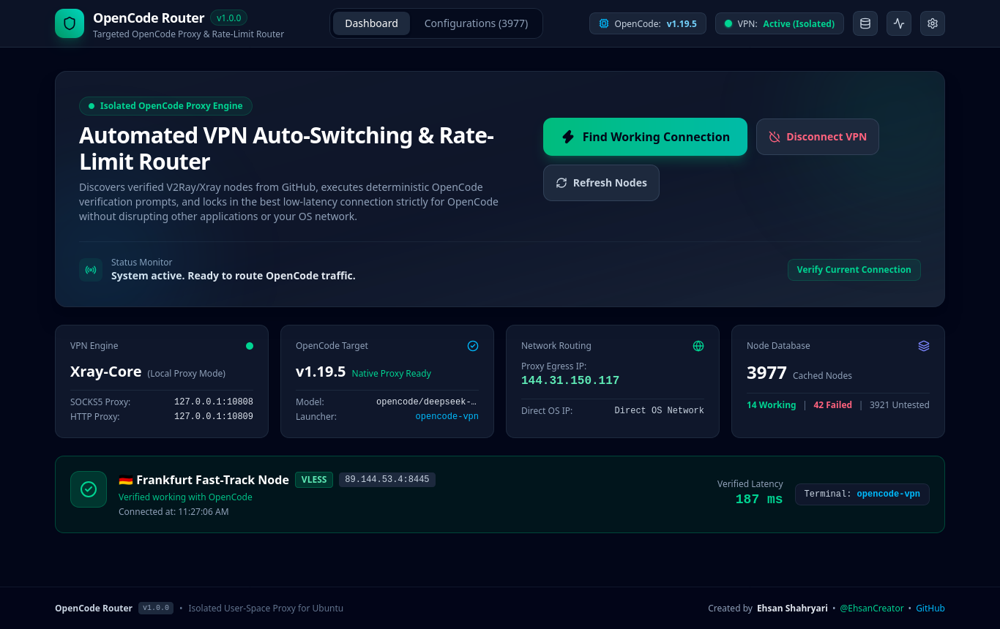
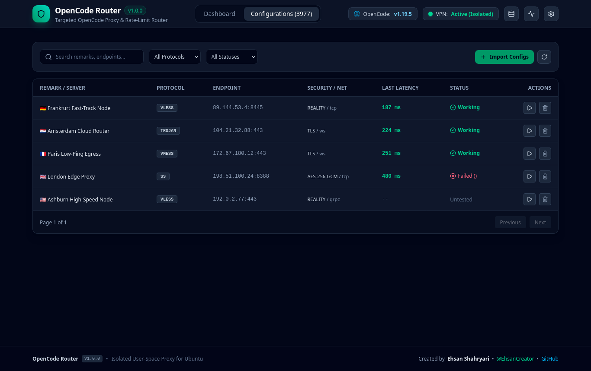

# OpenCode Router

<div align="center">

[](https://github.com/EhsanCreator/OpenCode-Router/releases)
[](LICENSE)
[]()
[]()
[](https://github.com/EhsanCreator)

**Intelligent, automated VPN auto-switching and rate-limit bypass router designed specifically for OpenCode on Ubuntu.**

[Key Features](#key-features) •
[Architecture](#system-architecture) •
[Quick Start](#quick-start) •
[Usage](#usage) •
[Security & Privacy](#security--privacy) •
[Author](#author)

</div>

---

## Overview

AI-powered code assistants such as **OpenCode** frequently encounter network roadblocks: regional ISP censorship, CDN firewalls, API gateway rate limits (HTTP 429), and IP-based free-tier throttling.

Traditional VPN clients disrupt developer productivity by redirecting all host operating system traffic through system-wide TUN adapters, breaking active SSH sessions, local microservices, database tunnels, and developer tools.

**OpenCode Router** provides an elegant, targeted solution. It discovers public V2Ray/Xray proxy configurations from GitHub, performs deterministic end-to-end verification directly through the installed OpenCode binary, and locks into the lowest-latency working node. All proxying runs in unprivileged user-space, isolating proxy routing exclusively to OpenCode without altering host network interfaces or routing tables.

---

## Screenshots

### Real-Time Dashboard


### Configuration & Node Manager


---

## Key Features

- **Automated Configuration Discovery**: Periodically aggregates, parses, and normalizes thousands of public proxy configurations from curated GitHub repositories and subscription endpoints.
- **Multi-Protocol Support**: Full native support for **VLESS** (with Reality, TLS, WebSocket, gRPC, TCP), **VMess** (AEAD, WebSocket, TCP), **Trojan**, and **Shadowsocks**.
- **Deterministic 3-Stage Verification Pipeline**:
  1. *Stage 1 (TCP)*: Verifies target server reachability and measures raw socket round-trip time.
  2. *Stage 2 (Proxy Handshake)*: Starts the local user-space proxy and probes egress IP reflection and HTTP response latency.
  3. *Stage 3 (Real OpenCode Session)*: Executes a non-interactive test prompt (`opencode run "Reply with: OK" --pure`) through the proxy to ensure the LLM endpoint is fully reachable and responsive.
- **Intelligent Error Classifier**: Accurately categorizes errors into `SUCCESS`, `RATE_LIMIT` (IP-based vs. account-level quota), `AUTH_ERROR` (invalid API keys), or `NETWORK_ERROR` (timeouts, TLS handshake failures), preventing infinite switching loops on authentication issues.
- **Isolated Target Execution (`opencode-vpn`)**: Includes a dedicated wrapper script (`bin/opencode-vpn`) that injects `http_proxy`, `https_proxy`, and `all_proxy` environment variables exclusively into OpenCode, keeping your OS, browsers, and terminal sessions unaffected.
- **Least-Privilege Security Architecture**: Requires **zero root privileges** for normal proxy operation. Runs unprivileged on user ports (`10808` SOCKS5, `10809` HTTP) and never asks for your sudo password during daily use.
- **Modern Responsive Web GUI**: Built with React 19, TypeScript, Vite, Tailwind CSS, and Server-Sent Events (SSE) for live streaming telemetry.
- **Persistent Local Caching**: Caches tested nodes, latency scores, and subscription history in a fast local SQLite database.

---

## System Architecture

```
                      +-----------------------------------------+
                      |         OpenCode Router Server          |
                      |  - Express & SQLite (Port 3000)         |
                      |  - Real-Time SSE Telemetry              |
                      +-------------------+---------------------+
                                          |
                +-------------------------+-------------------------+
                |                                                   |
                v                                                   v
+-------------------------------+                   +-------------------------------+
|     Discovery & Parser        |                   |      Connection Engine        |
| - GitHub Subscriptions        |                   | - Xray-core (User-Space)      |
| - VLESS / VMess / Trojan / SS |                   | - SOCKS5: 127.0.0.1:10808     |
| - SHA-256 Deduplication       |                   | - HTTP:   127.0.0.1:10809     |
+---------------+---------------+                   +---------------+---------------+
                |                                                   |
                +-------------------------+-------------------------+
                                          |
                                          v
                      +-----------------------------------------+
                      |       3-Stage Testing Pipeline          |
                      |  1. TCP Reachability (Ping & RTT)       |
                      |  2. Proxy Egress Handshake (HTTP Probe) |
                      |  3. Real OpenCode Verification Prompt   |
                      +-------------------+---------------------+
                                          |
                                          v
                      +-----------------------------------------+
                      |      Isolated Launcher Execution        |
                      |                                         |
                      |   bin/opencode-vpn                      |
                      |   ├── export http_proxy=127.0.0.1:10809 |
                      |   ├── export all_proxy=socks5://...     |
                      |   └── exec opencode "$@"                |
                      +-----------------------------------------+
```

---

## Quick Start

### Prerequisites
- **Operating System**: Ubuntu 20.04, 22.04, or 24.04 LTS
- **Node.js**: v18.0.0 or later (`node -v`)
- **Package Manager**: npm (`npm -v`)
- **Utilities**: `curl`, `unzip`
- **OpenCode**: Installed globally or in `/usr/local/bin/opencode`

### 1. Clone the Repository
```bash
git clone https://github.com/EhsanCreator/OpenCode-Router.git
cd OpenCode-Router
```

### 2. Install Dependencies
```bash
npm install
```

### 3. Launch OpenCode Router
Run the automated startup script:
```bash
./start.sh
```

The startup script automatically:
1. Downloads the Xray-core binary if not already present.
2. Compiles the modern React frontend.
3. Sets up executable permissions for `bin/opencode-vpn`.
4. Starts the backend server on `http://localhost:3000`.
5. Opens your default browser to the web dashboard.

---

## Usage

### Web Interface
1. Navigate to `http://localhost:3000` in your browser.
2. Click **Find Working Connection**.
3. OpenCode Router will cycle through ranked candidate nodes, run the 3-stage validation pipeline, and lock into the fastest working proxy.
4. Once verified, the dashboard displays the active egress IP, measured latency, and connection status.

### Command-Line Usage
Run your OpenCode sessions through the dedicated launcher wrapper:
```bash
# Interactive OpenCode session through the active proxy
bin/opencode-vpn

# Non-interactive command execution
bin/opencode-vpn run "Explain binary search in TypeScript"

# With pure output formatting
bin/opencode-vpn run "What is 2 + 2? Answer in one word." --pure
```

To make the launcher available system-wide for your user account:
```bash
mkdir -p ~/.local/bin
ln -sf "$(pwd)/bin/opencode-vpn" ~/.local/bin/opencode-vpn
```

Now you can invoke `opencode-vpn` from any terminal directory.

---

## Security & Privacy

OpenCode Router is designed with security and privacy as first-class principles:

- **Strict User-Space Isolation**: Does not modify global `/etc/resolv.conf`, system routing tables, or firewall rules. Existing tunnels, network interfaces, and host connections remain untouched.
- **Zero Sudo Requirement**: Standard proxying operates completely within unprivileged user ports (`10808` / `10809`).
- **Sanitized Data Storage**: All proxy configurations, connection logs, and SQLite database files are stored locally in `data/` and strictly excluded from Git tracking via `.gitignore`.
- **Zero Third-Party Analytics**: No analytics, telemetry, or external usage tracking are bundled or transmitted.
- **Optional Least-Privilege Setup**: If raw network socket capabilities are required on headless servers, `scripts/setup-privileges.sh` grants `cap_net_admin` to the single binary without requiring full root access.

---

## Project Structure

```
OpenCode-Router/
├── bin/
│   └── opencode-vpn            # Isolated OpenCode proxy launcher wrapper
├── docs/
│   └── images/                 # High-resolution application screenshots
│       ├── dashboard.png
│       └── configurations.png
├── scripts/
│   ├── create-desktop-launcher.sh # Ubuntu desktop & application menu installer
│   └── setup-privileges.sh        # Optional Linux capabilities security helper
├── src/
│   ├── backend/
│   │   ├── db/                 # SQLite database schema and helper methods
│   │   ├── discovery/          # GitHub repository crawler & subscription fetcher
│   │   ├── opencode/           # OpenCode CLI runner & error classifier
│   │   ├── orchestrator/       # Main auto-switching workflow state machine
│   │   ├── parser/             # VLESS, VMess, Trojan, and SS URI parsers
│   │   ├── tester/             # TCP latency and proxy egress probes
│   │   ├── vpn/                # Xray process manager & JSON config builder
│   │   └── server.ts           # Express HTTP and Server-Sent Events API
│   └── frontend/
│       ├── src/
│       │   ├── components/     # React dashboard, configuration table, modals
│       │   ├── App.tsx         # Main application component
│       │   └── main.tsx        # React entry point
│       ├── index.html          # Frontend HTML template
│       └── vite.config.ts      # Vite configuration
├── tests/
│   └── test-scenarios.ts       # Comprehensive automated test suite
├── .env.example                # Safe environment variables template
├── .gitignore                  # Git privacy & runtime artifact exclusion rules
├── CHANGELOG.md                # Release notes and version history
├── CONTRIBUTING.md             # Guidelines for open-source contributors
├── LICENSE                     # MIT License
├── package.json                # Project dependencies and npm scripts
├── README.md                   # Project documentation
├── SECURITY.md                 # Vulnerability disclosure policy
├── start.sh                    # One-command production launcher
└── tsconfig.json               # TypeScript compiler configuration
```

---

## Automated Test Suite

Run the full end-to-end test suite to verify protocol parsing, configuration building, error classification, and process isolation:
```bash
npm test
```

---

## Author

**Ehsan Shahryari**
- GitHub: [@EhsanCreator](https://github.com/EhsanCreator)
- Repository: [https://github.com/EhsanCreator/OpenCode-Router](https://github.com/EhsanCreator/OpenCode-Router)

---

## License

This project is licensed under the [MIT License](LICENSE) - see the [LICENSE](LICENSE) file for details.
